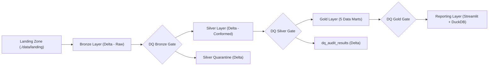

# Lakehouse Architecture Design Document

> **Instructions:** Complete each section below as you design and build your Medallion Lakehouse pipeline. Replace all `<!-- TODO: ... -->` placeholders with your concrete implementation choices, schema conventions, and Spark UI evidence. Refer to [`STUDENT_ASSIGNMENT.md`](./STUDENT_ASSIGNMENT.md) and [`SANITY_CHECKS.md`](./SANITY_CHECKS.md) for requirements.

---

## 1. System & Medallion Architecture Diagram

<!-- TODO: Expand this Mermaid diagram to reflect all 10 Bronze tables, your Silver cleansed & quarantine tables, the 5 Gold marts, DQ gates, Airflow orchestration, and the Streamlit/DuckDB reporting layer. -->



---

## 2. Storage Format & Partitioning Strategy

All zones are Delta Lake tables under `LAKEHOUSE_ROOT`. Every job takes `--batch-date` and is idempotent: re-running a date rewrites exactly what that date owns.

| Layer | Path Pattern | Partition Column(s) | Write / Idempotency Strategy |
| :--- | :--- | :--- | :--- |
| **Bronze (Full Load)** | `lakehouse/bronze/<table>` | None | Overwrite snapshot (older snapshots via Delta time travel) |
| **Bronze (Daily Batch)** | `lakehouse/bronze/<table>` | `_batch_date` | `replaceWhere _batch_date = '<batch_date>'` |
| **Silver facts** (`silver_timesheets`, `silver_invoices`, `silver_expenses`, `silver_crm_events`, `silver_survey_*`) | `lakehouse/silver/<table>` | `_batch_date` | `replaceWhere _batch_date = '<batch_date>'` (an empty result clears the partition) |
| **Silver dimensions** (`silver_clients`, `silver_projects`, `silver_employees_scd2`, `silver_fx_rates_daily`) | `lakehouse/silver/<table>` | None | Rebuilt from **all** Bronze and overwritten, so re-running an old date never truncates later history |
| **Silver Quarantine** | `lakehouse/silver_quarantine/<table>` | `_batch_date` | `replaceWhere _batch_date = '<batch_date>'` |
| **Gold** | `lakehouse/gold/<table>` | <!-- TODO --> | <!-- TODO --> |
| **DQ Audit** | `lakehouse/dq/dq_audit_results` | `batch_date` | Delete `(batch_date, layer, table_name)` + append |

**Reconciliation guarantee:** for every Silver fact table, `bronze rows = silver rows + quarantine rows` per batch. Superseded duplicates are quarantined with `duplicate_superseded` instead of being dropped. This was verified on the 14-day slice: timesheets `36,368 = 26,711 + 9,657`.

**Verified idempotency:** I fingerprinted all Silver, quarantine and DQ tables (row count + content hash excluding timestamps/run ids), re-ran Silver for `2026-01-05`, and fingerprinted again: every Silver table I wrote was identical. (The provided reference `silver_clients` job re-stamps `_batch_date` with the latest run; its content is unchanged.)

---

## 3. SCD Type 2 Design (`silver_employees_scd2`)

- **Source & rebuild:** all daily full snapshots in `bronze/employees`. The table is rebuilt and overwritten on each run, which is idempotent for a given Bronze state and cheap (1,200 employees × days).
- **Interval Convention:** closed `[valid_from, valid_to]` at day grain; `valid_to` = the day before the next version starts.
- **Open-End Sentinel:** `9999-12-31` (`is_current = true`), so point-in-time joins need no `NULL` handling.
- **Tracked attributes:** the required `department`, `role`, `hourly_rate_eur`, `is_active`, `termination_date`, `churn_type`, plus `seniority_level`, `work_mode`, `manager_id`, `last_promotion_date`, `distance_km` (needed for point-in-time HR and churn features). `full_name` and `hire_date` are carried from the snapshot that opened the version.
- **Collapsing unchanged snapshots:** `record_hash = sha2(to_json(struct(tracked...)))`; a snapshot opens a new version only when its hash differs from the employee's previous snapshot (`lag` over `snapshot_date`).
- **Validation:** typed snapshot rows failing domain/type rules (e.g. unknown department, unparseable rate, `is_active = false` without `termination_date`) are excluded from history and quarantined to `silver_quarantine/employees`.
- **DQ (ERROR):** unique `(emp_id, valid_from)`, no overlapping intervals, exactly one current version per employee, non-null keys.
- **Point-in-Time Join Condition:**
  ```sql
  ts.emp_id = emp.emp_id
  AND ts.work_date BETWEEN emp.valid_from AND emp.valid_to
  ```
  The same predicate drives the zombie-timesheet check in Silver (`work_date >= emp.termination_date` on the version valid at `work_date`).

---

## 4. Near-Duplicate Tie-Breaker Policy

All dedup uses `Window.partitionBy(key).orderBy(...)` + `row_number() = 1` (helper `spark_jobs/silver/_common.py::deduplicate`). Validation runs **before** dedup, so the first sort key is always `size(dq_reasons) ASC`: a valid copy always beats an invalid one. The remaining keys form a total order over every column that can differ, so the kept row never depends on file or partition order, and re-runs keep the same record. Superseded rows go to quarantine (`duplicate_superseded`).

| Dataset | Business Key | Tie-Breaker Ordering Rule | Rationale |
| :--- | :--- | :--- | :--- |
| `timesheets` | `ts_id` | valid first → `hours ASC` → `project_id`, `emp_id`, `work_date` | Near-duplicates differ only in `hours` (e.g. 1.75 vs 2.25); keeping the lowest valid value is the conservative billing choice |
| `expenses` | `exp_id` | valid first → `amount ASC` → `department`, `category`, `currency`, `expense_date` | Near-duplicates differ only in `amount`; lowest valid amount is conservative for cost reporting |
| `employee_surveys` | `survey_id` | valid first → `submitted_ts ASC` → `sha2(answers)` | Duplicates are exact re-submissions; the earliest submission is the canonical answer |
| `invoices` / `crm_events` / `fx_rates` | `inv_id` / `event_id` / `(rate_date, pair)` | valid first → latest `_ingested_at` → value columns | Defensive (no duplicates observed); latest ingestion wins |

---

## 5. Spark Shuffle Skew Analysis (`crm_events` — `VIP_CORP_001`)

`VIP_CORP_001` accounts for roughly **45%** of all `crm_events` rows, causing severe skew during distributed joins/aggregations against `silver_clients`.

<!-- TODO: Document:
1. Baseline skewed run behavior (what went wrong / long tail task durations).
2. Skew mitigation technique implemented (e.g., Broadcast Join, Spark AQE skew join, or Key Salting — explain why and include Spark configs/salting factor).
3. Before vs. After metrics from the Spark UI / Spark History Server (`http://localhost:18080`).
4. Embed or link Spark UI screenshots saved under `docs/images/` (do not commit huge binaries if avoidable; keep compressed PNGs small).
-->

### Before vs. After Skew Mitigation Metrics

| Metric | Unoptimized (Skewed Shuffle Join) | Optimized (Your Strategy) |
| :--- | :---: | :---: |
| **Strategy / Config** | Sort-Merge Join (default) | <!-- TODO --> |
| **Stage Duration** | <!-- TODO --> | <!-- TODO --> |
| **Max Task Duration vs. Median** | <!-- TODO --> | <!-- TODO --> |
| **Max Shuffle Read Size per Task** | <!-- TODO --> | <!-- TODO --> |
| **Spill (Memory / Disk)** | <!-- TODO --> | <!-- TODO --> |

### Spark UI Screenshots

<!-- TODO: Add screenshots showing stage task summary / event timeline before and after optimization. -->
- **Baseline (Skewed):** `<!-- TODO: add screenshot link -->`
- **Optimized:** `<!-- TODO: add screenshot link -->`

---

## 6. Data Quality & Quarantine Architecture

Each Silver job writes all of its checks for a table to `dq_audit_results` in one call, then calls `enforce_dq_gate` (any `ERROR` failure raises `DQGateFailedError` and fails the task). Reusable checks live in `dq/checks.py`.

**Quarantine routing:** invalid rows go to `silver_quarantine/<table>` with every failed rule in `dq_reasons` and the `_batch_date`. Nothing is silently dropped.

| Layer | Table | Check Name | Severity | Rule / Threshold | Action on Failure |
| :--- | :--- | :--- | :---: | :--- | :--- |
| Silver | all Silver tables | `not_null_<pk>` | `ERROR` | Primary-key columns are never NULL | Fail task |
| Silver | all Silver tables | `unique_<pk>` | `ERROR` | PK unique within the batch (`(emp_id, valid_from)` for SCD2) | Fail task |
| Silver | `silver_employees_scd2` | `scd2_no_overlapping_intervals` | `ERROR` | Next `valid_from` > current `valid_to`; `valid_to >= valid_from` | Fail task |
| Silver | `silver_employees_scd2` | `scd2_exactly_one_current_version` | `ERROR` | One `is_current` row per `emp_id` | Fail task |
| Silver | `silver_invoices`, `silver_expenses` | `zero_null_amount_eur` | `ERROR` | No NULL `amount_eur` after FX conversion (a missing rate is a pipeline fault, so it fails rather than quarantines) | Fail task |
| Silver | `silver_fx_rates_daily` | `not_null_..._rate` | `ERROR` | Spine has 0 NULL rates | Fail task |
| Silver | every quarantining table | `quarantine_ratio` | `WARN` | Validation failures / distinct rows > 8% | Log, continue |
| Silver | timesheets, expenses, invoices, survey responses | `duplicate_rate` | `WARN` | Superseded duplicates / bronze rows > 5% | Log, continue |
| Silver | `silver_invoices` | `orphan_project_id_rate` | `WARN` | Orphan invoices / bronze rows > 2% (~1% observed) | Log, continue |
| Silver | `silver_timesheets` | `zombie_timesheet_count` | `WARN` | Any `work_date >= termination_date` row | Log, continue |
| Silver | `silver_survey_answers` | `score_out_of_range_rate` | `WARN` | Out-of-bounds answers > 1% | Log, continue |
| Silver | `silver_survey_answers` | `missing_written_comment_rate` | `WARN` | Blank `written_answer` > 2% (flagged `has_written_comment = false`, not quarantined) | Log, continue |
| Silver | `silver_fx_rates_daily` | `stale_forward_filled_rate` | `WARN` | Any rate carried forward ≥ 4 days (a missing weekday file) | Log, continue |
| Silver | `silver_crm_events` | `skewed_key_share_vip_corp_001` | `WARN` | Informational: `VIP_CORP_001` share > 60% (~45% expected) | Log, continue |
| <!-- TODO: Bronze & Gold gates --> | | | | | |

**Observed on the 14-day slice:** all `ERROR` checks pass. WARN fires daily for the timesheet quarantine ratio (~19% of distinct entries invalid) and for timesheet/expense duplicate rates (~9%). These are genuine source issues, so the warnings are the intended signal.

> **Dataset drift vs. `SANITY_CHECKS.md`:** distinct-key counts match exactly (33,051 timesheets, 6,552 expenses, 746 surveys, 43 orphan invoices, 42,507 CRM events / 19,151 VIP, 84 FX rows). Duplicate and anomaly counts in the downloaded landing files are about 2× the documented ones (e.g. 36,368 raw timesheets vs 34,675; 441 European `issued_at` strings vs 211), verified directly on the raw files. Silver reconciles exactly against the actual data.

## 7. Orchestration & Reporting Layer Design

<!-- TODO: Summarize your Airflow DAG schedule, task dependencies, retry/timeout policies, Gold mart refresh pattern, and how DuckDB reads Delta tables in Streamlit. -->
